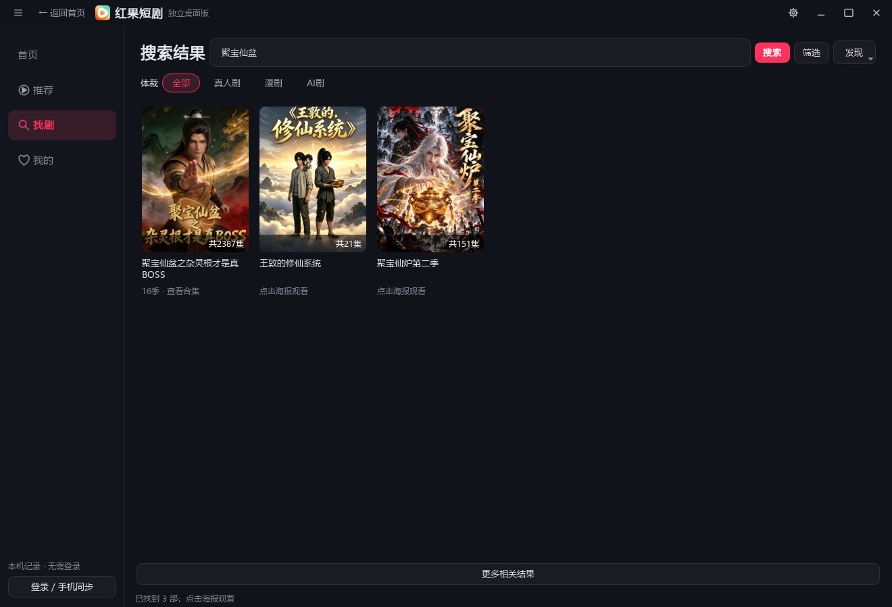
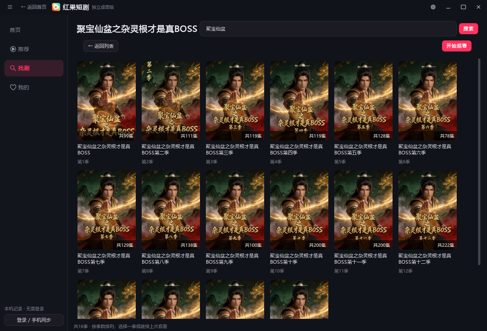
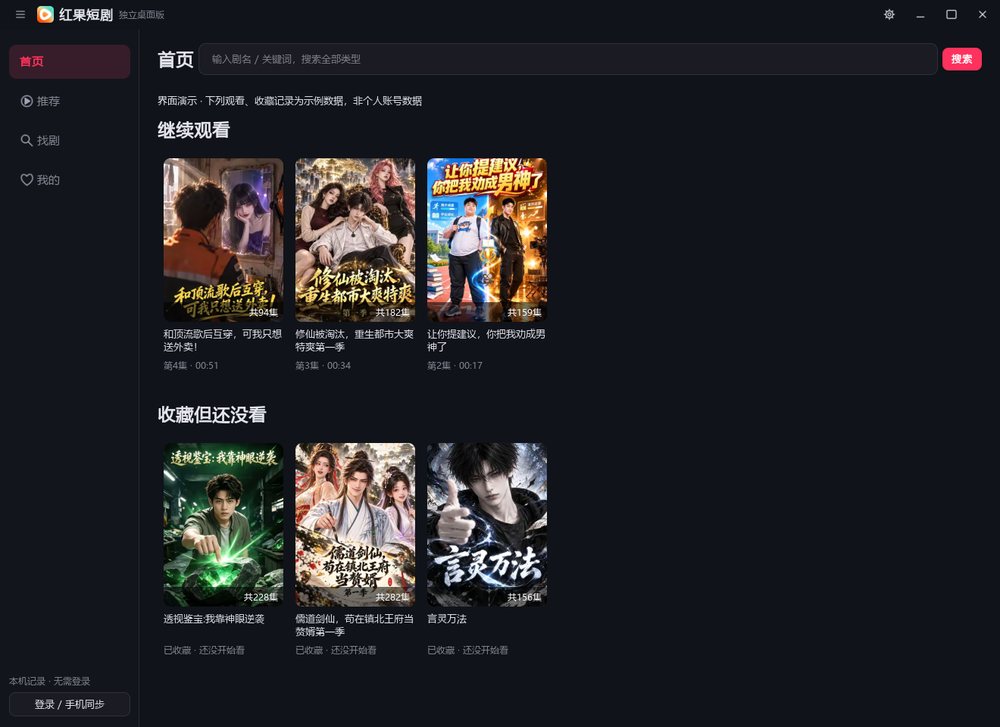
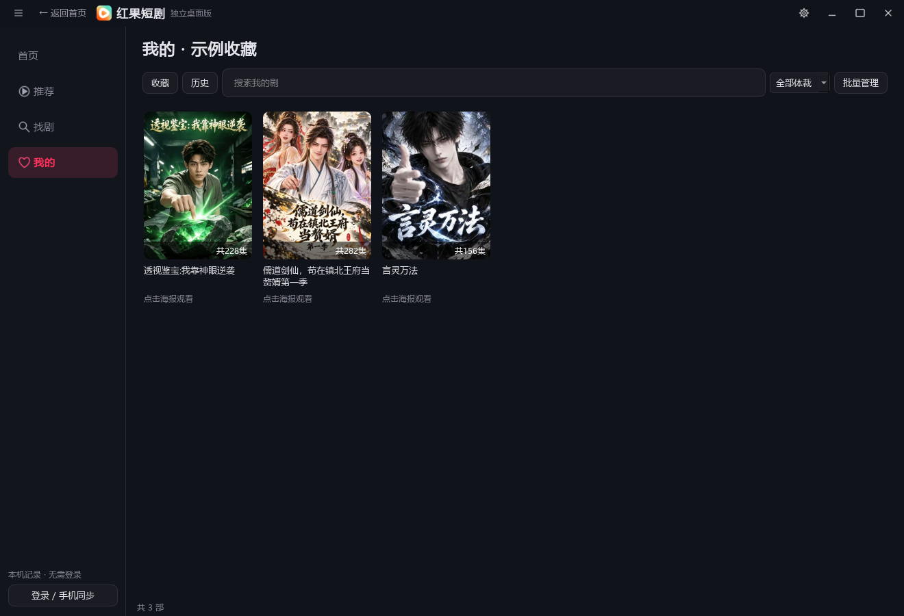

<h1 align="center">红果短剧</h1>

独立桌面播放器 找剧、刷剧、接着看。

  
  
  

  <a href="https://github.com/songdx1019-star/hongguo-desktop-releases/releases/download/v3.7.2/Hongguo-Desktop-v3.7.2-Windows-x64.zip"><b>下载 Windows v3.7.2</b></a> ·
  <a href="https://github.com/songdx1019-star/hongguo-desktop-releases/releases">版本记录</a> ·
  <a href="https://github.com/songdx1019-star/hongguo-desktop-releases/issues">反馈问题</a>

在电脑上搜索完整短剧、连续播放，在需要时切换紧凑小窗。支持整窗透明度、真实时间轴弹幕，以及红果账号的观看进度与收藏同步。

## 下载与安装

| 平台 | 版本 | 下载 |
| :--- | :--- | :--- |
| Windows 10 / 11，64位 | v3.7.2 | [下载 ZIP](https://github.com/songdx1019-star/hongguo-desktop-releases/releases/download/v3.7.2/Hongguo-Desktop-v3.7.2-Windows-x64.zip) · [SHA-256 校验](https://github.com/songdx1019-star/hongguo-desktop-releases/releases/download/v3.7.2/SHA256SUMS.txt) |
| macOS | 待发布 | 尚无经过 Mac 实机构建验证的安装包 |

完整解压后，双击 `红果短剧.exe` 即可运行，无须安装安卓模拟器。保留同目录的 `_internal` 等随包文件；升级时先退出旧版。

## v3.7.2 更新

- 短暂暂停或隐藏后直接续播；长时间离开后只确认当前剧的云端进度，不等待整库同步。
- 进度条支持点击目标位置直接跳转，显示目标时间与完成状态；暂停时跳转保持暂停，以实际解码画面确认结果。
- 收藏、历史增量更新，保留卡片、选择和滚动位置；封面仅按可见区域加载，解码在后台完成。
- 搜索提交后立即收起联想，丢弃过期回复，联想列表使用深色样式。
- 撤下未接入官方预约的本机订阅弹窗与入口，不再把本机提醒作为预约功能。

## 四个入口，日常够用

| 首页 | 推荐 | 找剧 | 我的 |
| :--- | :--- | :--- | :--- |
| 继续观看、收藏未看 | 滚轮换剧，喜欢再进入剧集 | 搜索整剧、按季选择，支持筛选 | 收藏与历史统一管理，可搜索和批量操作 |

- 连续播放：下一集和下一部提前准备，加载失败自动重试；显示取片源、下载和缓冲状态。
- 整剧搜索：同一部剧的多季聚合为一个入口，展开后按季排列，返回保留搜索结果。
- 轻量播放：鼠标进入底部才显示控制条；倍速旁快速选集，画面右侧保留收藏与进入剧集。
- 推荐偏好：支持不感兴趣、减少这类、隐藏已看；偏好保存在当前账号的本机记录中。
- 弹幕与画质：真实时间轴弹幕可开关，默认最高可用片源，可选锐化或 Anime4K 增强。
- 日常管理：排行榜、新剧和日历在找剧的“发现”菜单；分享和推荐反馈在播放器的“更多”菜单。

## 小窗与透明度

<table>
<tr><th>紧凑小窗</th><th>独立设置</th></tr>
<tr>
<td align="center"></td>
<td align="center"></td>
</tr>
</table>

整个窗口支持 30%～100% 透明度，包含视频和控件。深色、白色或自定义底色搭配画面融色，主窗口与小窗分别记忆。

设置为独立、不透明的窗口，按外观、播放、快捷键分类。小窗随视频比例调整，减少空白；隐藏和最小化时暂停播放。

## 更多界面

整剧搜索与按季选剧

合集条目以实际接口返回为准，尚未上线或没有分集的条目不代表可以播放。

追剧首页与我的剧库

下图的观看、收藏及更新记录为明确标注的示例数据，不含个人账号记录；封面来自实时匿名剧库。

快速选集与播放设置

画质增强会增加准备时间，设备不支持时自动回退普通画质。

## 登录与接续

使用手机红果 App 扫描官网二维码登录。游客记录保存在本机；登录后按账号隔离，接入官方历史、进度和收藏通道。

观看时定时保存，暂停、隐藏和退出时提交最后位置。未确认的提交保留在本机；短暂暂停或隐藏直接续播，长时间离开后只确认当前剧的云端进度，保护较新的手机进度。休眠唤醒、断网恢复会触发刷新；登录明确失效时需要重新扫码，不清空待同步记录。

历史和进度接口已做真实云端回读对照。手机最终界面接续、长期真实休眠、收藏双向完整操作仍需实机验收；离线关闭后不能保证进度立即出现在手机。官方点赞、评论、弹幕互动及预约双向同步尚未完成，未提供预约入口。

## 常用操作

| 操作 | 效果 |
| :--- | :--- |
| `Ctrl + D` | 全局隐藏／显示；隐藏暂停，恢复遵循隐藏前状态 |
| `Shift + 鼠标滚轮` | 当前窗口透明度每次调整5% |
| 空格／点击视频 | 播放／暂停 |
| 滚轮／`↑`、`↓` | 推荐模式换短剧，剧集模式换分集 |
| 倍速旁的“选集” | 快速选择当前短剧的集数 |
| 右上角 `—` | 最小化并暂停；恢复后保持暂停 |
| 右上角齿轮 | 外观、播放、全局快捷键及更新设置 |

全局快捷键可修改或关闭，占用时会提示。软件更新入口前往本仓库发布页。

## 说明与反馈

个人维护的非官方客户端，与红果短剧官方无关。本仓库存放安装包、使用说明与展示图，不公开上传开发源码。第三方许可随软件保留，见 `LICENSE`、`THIRD_PARTY_NOTICES.md` 和 `licenses`。

Windows 版通过211项回归测试，并使用隔离数据离屏验证真实搜索、视频解码、自动下一集、透明度配置、弹幕及隐藏／最小化暂停。展示图由程序自身的离屏窗口生成，未截取用户桌面；Windows 验证不代替 Mac 验收。

内容与账号接口、网络状态及设备能力可能影响播放。安装包未做发行者数字签名，可使用随 Release 提供的 SHA-256 核对。

反馈请附软件版本、Windows版本、剧名／集数及错误文字。不要公开登录二维码、Cookie、账号会话或个人观看记录。

<a href="https://github.com/songdx1019-star/hongguo-desktop-releases/releases/latest">下载最新版</a> · <a href="https://github.com/songdx1019-star/hongguo-desktop-releases/issues">提交反馈</a>

