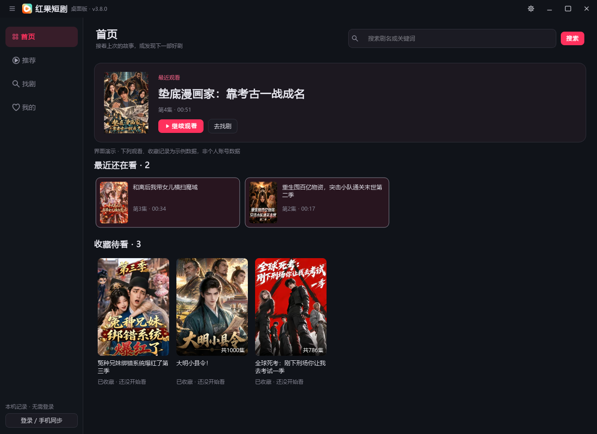
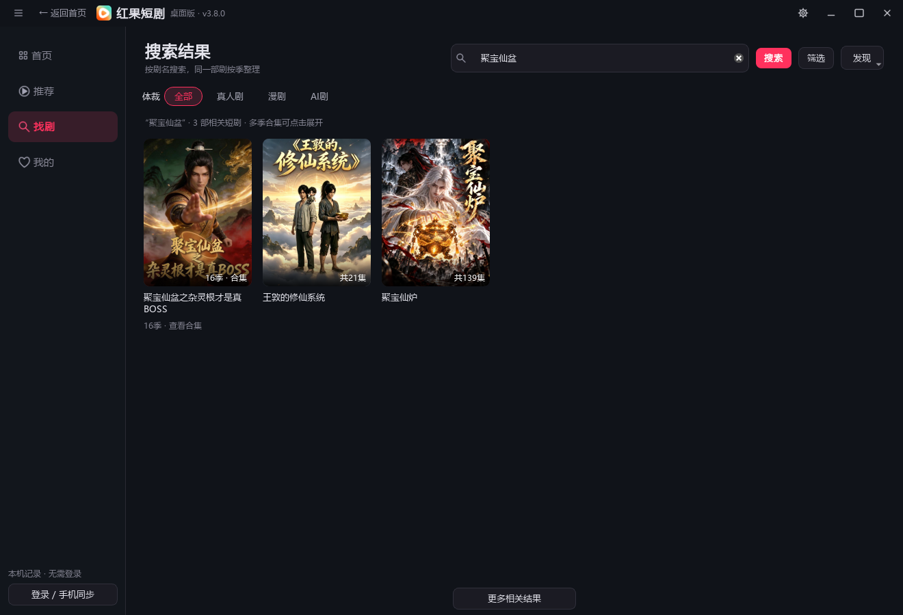
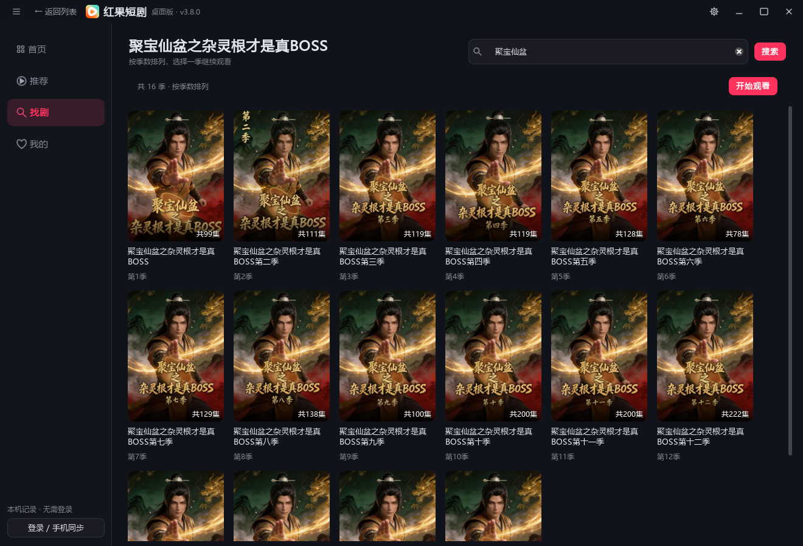
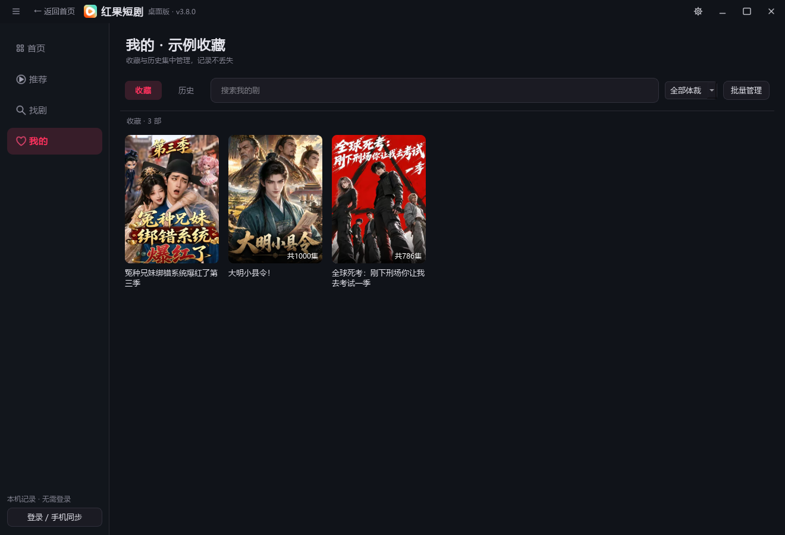
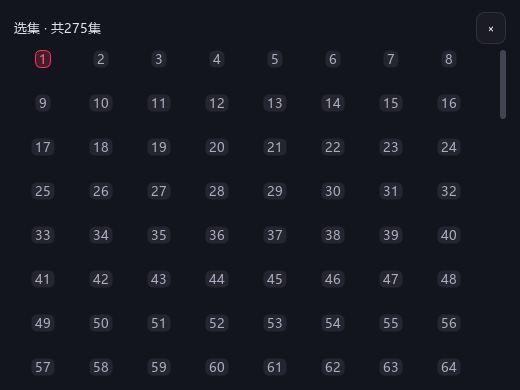
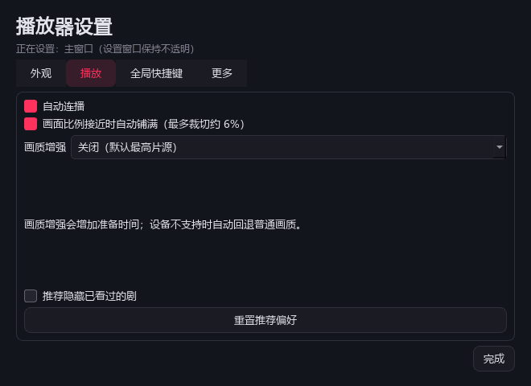
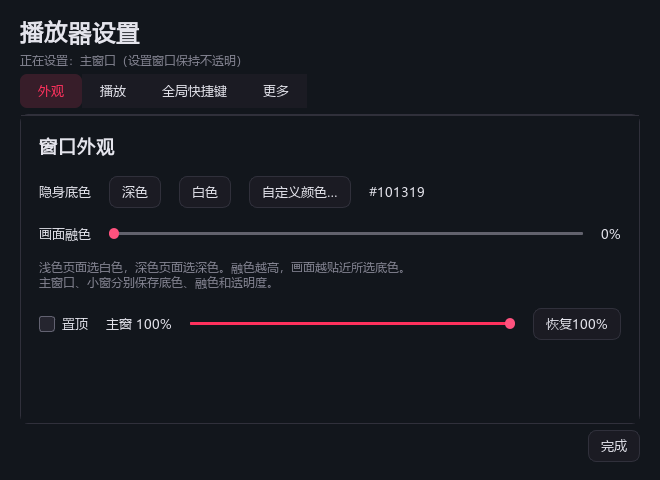

<h1 align="center">红果短剧 · 桌面版</h1>

继续上次的故事，发现下一部好剧。 在电脑上搜索、刷剧、连播，也能切换透明小窗。

  
  
  

  <a href="https://github.com/songdx1019-star/hongguo-desktop-releases/releases/download/v3.8.0/Hongguo-Desktop-v3.8.0-Windows-x64.zip"><b>下载 Windows v3.8.0</b></a> ·
  <a href="https://github.com/songdx1019-star/hongguo-desktop-releases/releases">版本记录</a> ·
  <a href="https://github.com/songdx1019-star/hongguo-desktop-releases/issues">反馈问题</a>

## 下载与安装

| 平台 | 状态 | 下载 |
| :--- | :--- | :--- |
| Windows 10 / 11，64 位 | v3.8.0 | [下载运行包](https://github.com/songdx1019-star/hongguo-desktop-releases/releases/download/v3.8.0/Hongguo-Desktop-v3.8.0-Windows-x64.zip) · [SHA-256 校验](https://github.com/songdx1019-star/hongguo-desktop-releases/releases/download/v3.8.0/SHA256SUMS.txt) |
| macOS | 待发布 | 暂无经过 Mac 本机构建和播放验证的安装包 |

1. 先退出正在运行的旧版。
2. 完整解压 ZIP，双击 **红果短剧.exe**。
3. 保留同目录的 `_internal` 和其他随包文件，无须另装安卓模拟器、Java 或解码组件。

安装包未做发行者数字签名，可以使用发行页的 SHA-256 核对文件。软件内的更新入口会前往本仓库发布页。

## v3.8.0 更新

- **恢复片源获取**：跟进新版官方播放接口，修复一批后续分集返回空内容的问题。
- **增加编码兼容**：支持 ByteVC2 片源转换；同分辨率优先兼容轨道，硬件转换失败时复用原文件进行软件转换。
- **提前准备下一集**：准备完整本地文件，切集使用已有缓存；耗时操作在后台进行，并区分片源、下载和缓冲状态。
- **整理日常界面**：首页突出继续观看，最近观看改为横向小卡，收藏与历史集中管理。
- **减少重复提示**：删除海报下反复出现的操作文字、重复返回入口和过时的空画面说明。

本轮实际播放器验证《我合成了全世界啊第3季》第 **281～286 集**出画，五次切集使用完整预加载文件，覆盖第 283、285 集的 ByteVC2 片源。测试使用暂停和片尾跳转触发切集，没有完整观看六集全程；这些结果不代表所有剧目和网络环境都已验收。

## 四个入口，清楚好找

| 入口 | 适合做什么 |
| :--- | :--- |
| **首页** | 一键继续最近观看，查看其他在追的剧和收藏待看 |
| **推荐** | 用滚轮换一部剧，喜欢后进入剧集继续播放 |
| **找剧** | 按剧名搜索，展开多季合集，按顺序选择季数 |
| **我的** | 切换收藏与历史，搜索、筛选和批量管理记录 |

首页直接展示最近一部剧的集数和位置；其他最近观看使用紧凑卡片，给收藏待看留出空间。没有记录时提供找剧和推荐入口。

## 找到整部剧，再按季选择

同一官方合集的多季聚合为一个入口，展开后按季数排列。返回时保留原搜索列表和位置，搜索联想在提交后收起。

剧目、季数与可播放范围以平台实际返回为准；尚未上线或没有分集的条目不代表可以播放。排行榜、新剧和上新日历收在找剧的“发现”菜单。

## 收藏与历史，集中管理

收藏、历史使用清楚的切换标签，支持关键词搜索、体裁筛选和批量管理。更新记录时尽量保留卡片、选中状态和滚动位置；没有匹配结果时可一键清除筛选。

## 播放控制，用时再出现

鼠标进入底部控制区域时，进度条和操作按钮从下方渐入；移出后渐出。点击或拖动进度条时显示目标时间，暂停跳转保持暂停。

倍速旁的“选集”可以快速跳到指定分集。推荐模式滚轮换短剧，进入剧集后滚轮换分集。

支持官方时间轴弹幕开关、自动连播和可选画质增强，默认选择片源提供的最高分辨率。增强或编码转换可能增加首次准备时间，实际效果取决于片源与设备。

## 透明小窗，按习惯调整

整窗支持 **30%～100% 透明度**，视频与控件一起生效。可以选择深色、白色或自定义底色，配合画面融色使用；主窗口和小窗分别记忆外观配置。

<table>
  <tr><th>紧凑小窗</th><th>独立设置窗口</th></tr>
  <tr>
    <td align="center"></td>
    <td align="center"></td>
  </tr>
</table>

小窗按视频比例调整，减少空白。设置保持独立、不透明，便于调节；隐藏窗口和点击最小化都会暂停视频。

## 登录与手机接续

- **未登录**：观看和收藏记录保存在本机。
- **登录**：使用手机红果 App 扫描官网二维码，并在手机上确认。
- **观看过程中**：定时保存进度，暂停、隐藏和退出时提交最后位置；未确认的提交保留在本机。
- **再次继续**：短暂暂停直接续播，长时间离开后确认本剧云端位置；明确登录过期时提示重新扫码。

已接入官方历史、播放进度和收藏通道。手机最终界面的接续、真实长期休眠及收藏完整双向操作仍需实机验收；断网退出时不能保证进度立即出现在手机上。

官方点赞、评论、弹幕互动及预约双向同步尚未完成，当前没有预约入口。

## 常用操作

| 操作 | 快捷方式 |
| :--- | :--- |
| 全局隐藏／显示 | **Ctrl + D**；隐藏暂停，恢复遵循隐藏前状态 |
| 调节透明度 | **Shift + 鼠标滚轮**；每次调整 5% |
| 播放／暂停 | 空格或点击视频 |
| 换剧／换集 | 滚轮或方向键 ↑、↓ |
| 快速选集 | 倍速旁的“选集” |
| 最小化并暂停 | 右上角 `—`；恢复后保持暂停 |
| 外观与快捷键 | 右上角齿轮，打开独立设置 |

全局快捷键可以修改或关闭；被其他软件占用时会提示。

## 验证与反馈

v3.8.0 通过 **240 项 Python 全量回归**、最终 **17 项相关检查**、**31 项 Node 测试**，以及打包程序的离屏真实播放自检。测试覆盖指定分集出画、预加载切集、透明度、小窗、隐藏恢复和最小化暂停；Windows 的结果不能代替 macOS 验收。

展示图由程序自身的离屏窗口生成，没有截取工作桌面。首页与剧库中的观看、收藏为已标注的示例记录；剧目信息和封面来自公开目录，播放器截图使用真实视频画面。

如需反馈，请提供 **软件版本、Windows 版本、剧名、集数和错误文字**，便于定位。不要公开登录二维码、Cookie、会话或个人观看记录。

这是个人维护的非官方客户端，与红果短剧官方无隶属关系。本仓库用于发布运行包、说明和展示图，不公开上传应用源码；第三方组件许可和相关对应源码保留在软件包内。内容接口、网络和设备能力会影响可播放范围。

  <a href="https://github.com/songdx1019-star/hongguo-desktop-releases/releases/latest">下载最新版</a> ·
  <a href="https://github.com/songdx1019-star/hongguo-desktop-releases/issues">提交反馈</a>

