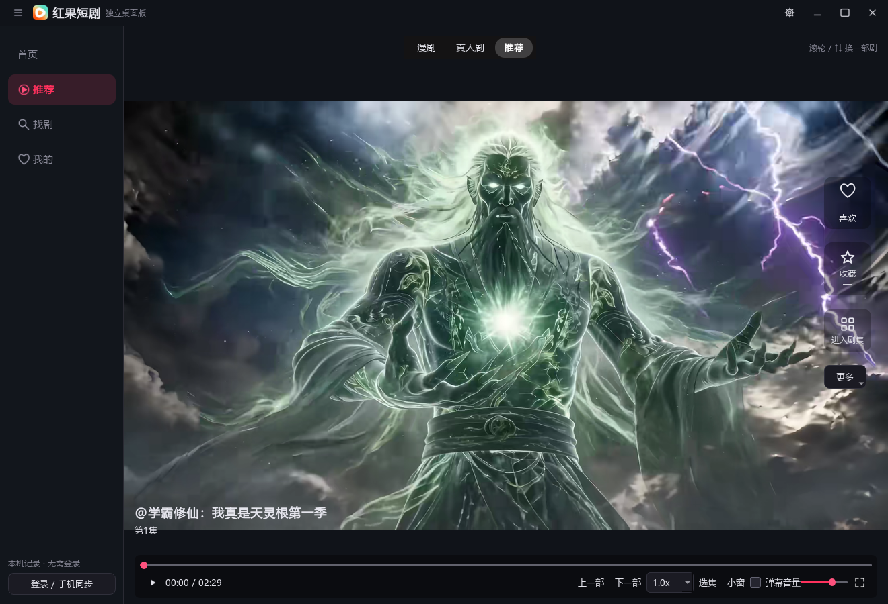
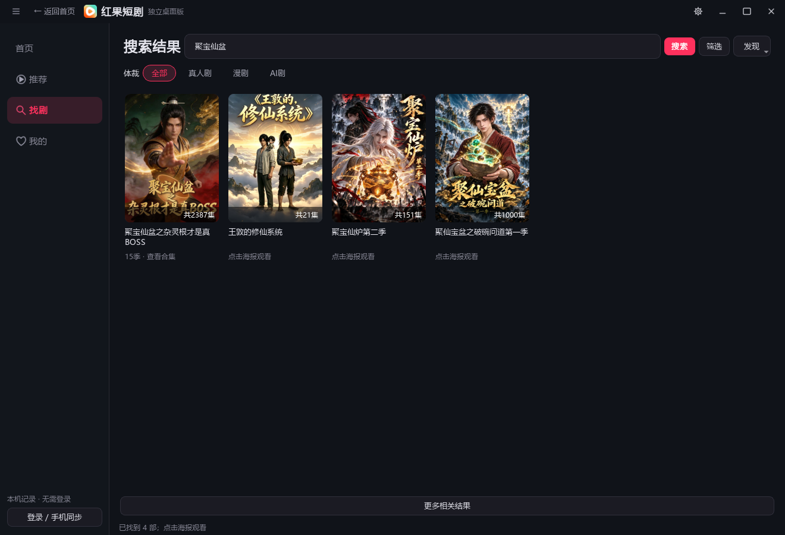
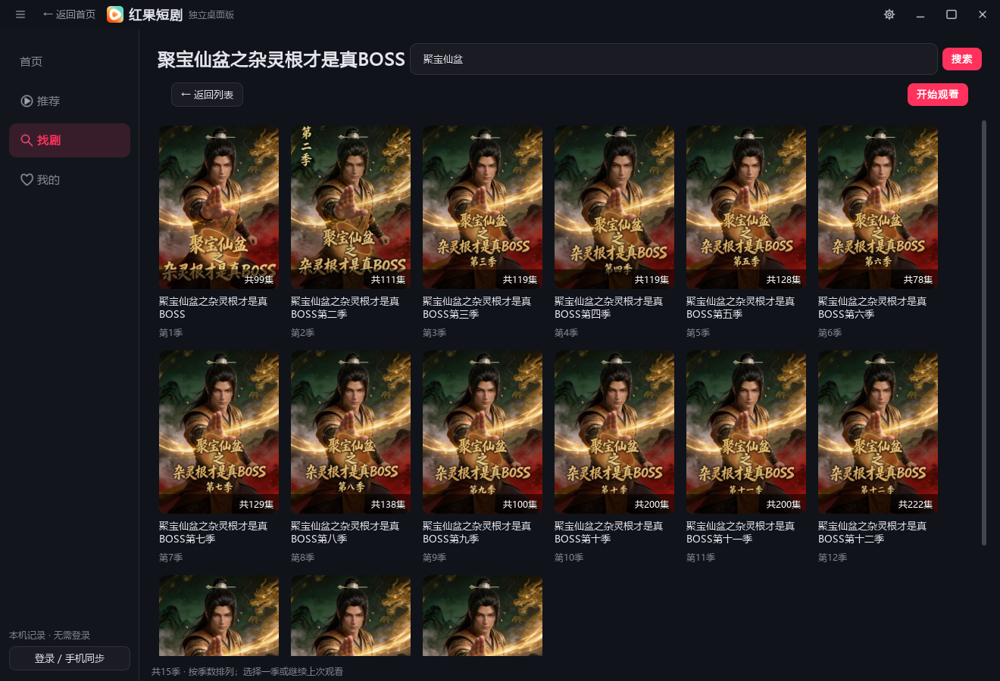
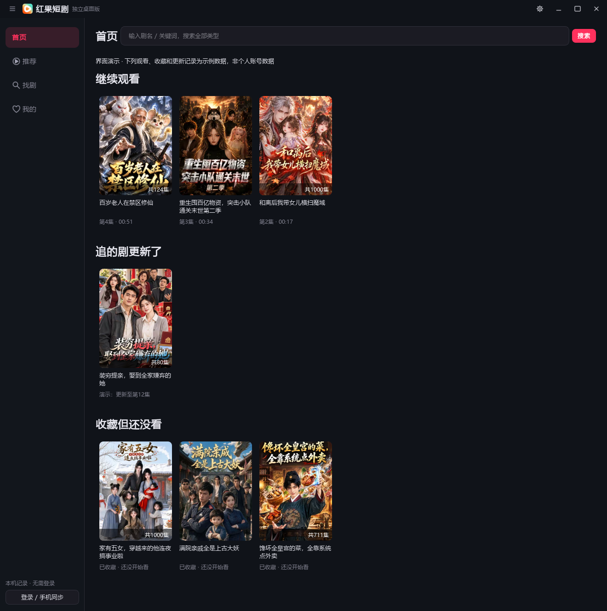
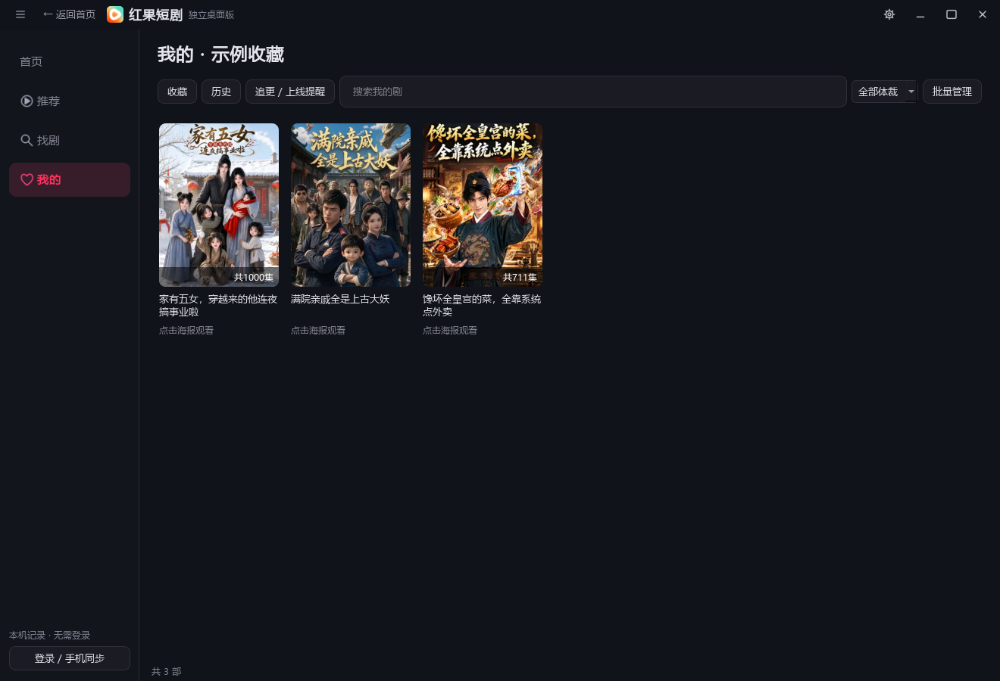
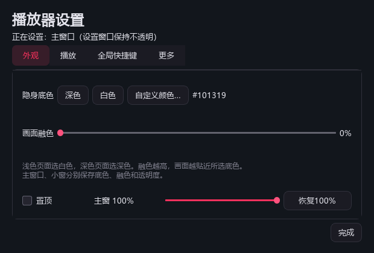
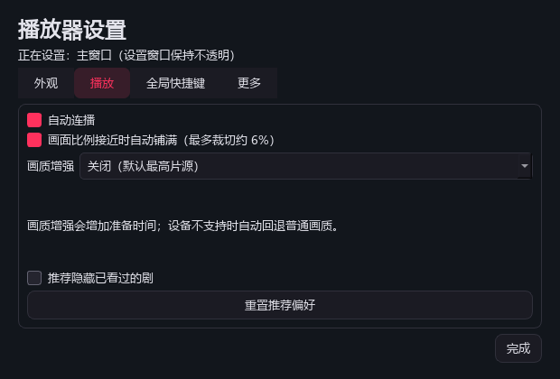

# 红果短剧

### 独立桌面播放器 · 桌面刷剧，轻一点

整剧搜索 · 沉浸播放 · 紧凑小窗 · 窗口透明度

[**下载 Windows 公开版**](https://github.com/songdx1019-star/hongguo-desktop-releases/releases/download/v3.6.0-preview.3/Hongguo-Desktop-v3.6-preview3-Windows-x64.zip)　·　[版本记录](https://github.com/songdx1019-star/hongguo-desktop-releases/releases)　·　[问题反馈](https://github.com/songdx1019-star/hongguo-desktop-releases/issues)

个人维护的非官方客户端，与红果短剧官方无关。

> **版本说明**：下面展示的是 **v3.7 精简预览2**的实际程序界面，目前作为本地预览交付；GitHub 公开下载仍为 **v3.6 预览3**，界面与部分功能会有差异。macOS 尚无通过实机构建验收的安装包。

## 少一点入口，顺一点操作

| 首页 | 推荐 | 找剧 | 我的 |
| :--- | :--- | :--- | :--- |
| 继续观看、追剧更新、收藏未看 | 滚轮换一部剧，喜欢再进入剧集 | 搜索整部剧，按季选择；筛选与发现菜单 | 收藏和历史集中管理，支持搜索与批量操作 |

**这次做了减法：**撤下侧栏重复的续播、历史管理、提醒、日历和设置入口；合并历史与收藏页面；选集只保留倍速旁的入口；小窗、全屏各保留一个按钮。分享和推荐反馈放进“更多”，设置按外观、播放、快捷键分组。本地视频、裸视频链接播放及常驻分集侧栏已移除。

## 界面与体验

### 看剧时，把空间留给画面

- 推荐模式下，鼠标滚轮／方向键切换**另一部剧**；进入剧集后，改为切换**上一集／下一集**。
- 控制条在鼠标进入底部区域时渐入，移出渐出；拖动进度、选择集数或倍速时保持显示。
- 下一集和下一部提前准备；片源、下载与缓冲状态分别显示。失败最多自动重试两次，仍失败时提供重试入口。
- 推荐右侧展示官方提供的全剧喜欢与收藏数量；没有数据时显示“—”。小窗隐藏这些统计。

<b>查看：整部剧搜索与按季选择</b>

同一部剧的多季聚合为一个入口，进入后按季排列。合集可继续最近看过的一季，返回时保留搜索结果。

“聚宝仙盆”本次返回16季元数据，包含第1至15季；未提供分集或尚未上线的条目不代表可以播放。

<b>查看：追剧首页与统一的“我的”</b>

打开首页先看继续观看、已确认更新和收藏未看。收藏与历史在“我的”内切换，搜索、体裁筛选及批量管理在同一页完成。

**以下两张图的观看、收藏及更新记录为明确标注的示例数据，不含个人账号记录。封面来自实时匿名剧库。**

<b>查看：快速选集</b>

倍速旁点击“选集”，弹出当前短剧的集数列表；不再同时展开一块常驻选集侧栏。

### 小窗紧凑，设置独立

<table>
<tr><th>按视频比例收紧的小窗</th><th>独立外观设置</th></tr>
<tr>
<td align="center"></td>
<td align="center"></td>
</tr>
</table>

- 整个窗口支持 **30%～100% 透明度**，包含视频与控件；主窗口、小窗分别保存。
- 深色、白色或自定义底色搭配画面融色，适应不同桌面背景。
- 设置始终是独立、不透明的窗口，点击设置不会在主界面下方追加面板。
- 真实时间轴弹幕可开关；小窗使用独立动画时钟。没有弹幕时不生成假内容。

<b>查看：播放设置</b>

默认选择最高可用片源，可选锐化或 Anime4K。增强会增加准备时间，设备不支持时自动回退；推荐偏好只保存在当前账号的本机记录中。

## 登录与接续播放

使用手机红果 App 扫描官网二维码登录。未登录时记录保存在本机；登录后按账号隔离，并通过官方账号通道同步历史、进度和收藏。

**已接入的保护：**观看时定时保存，暂停、隐藏和关闭时提交最后位置；未确认的提交留在本机队列。恢复播放会刷新云端进度，并保护较新的手机记录。休眠唤醒、断网恢复会触发刷新；明确登录失效时提示重新扫码，不清空待同步记录。

**验收边界：**历史和进度接口已做过真实回读对照；手机最终界面接续、长时间真实休眠、收藏双向完整操作仍待实机验收。离线关闭后不能保证进度立即出现在手机。官方点赞、评论、弹幕互动和预约双向同步尚未完成；本机追更提醒不等于手机官方预约。

## 常用操作

| 操作 | 效果 |
| :--- | :--- |
| **Ctrl + D** | 全局隐藏／显示；隐藏暂停，恢复遵循隐藏前状态 |
| **Shift + 鼠标滚轮** | 当前窗口透明度每次调整5% |
| **空格／点击视频** | 播放／暂停 |
| **滚轮／↑ ↓** | 推荐模式换短剧，剧集模式换分集 |
| **倍速旁“选集”** | 快速选择当前短剧的集数 |
| **右上角 —** | 最小化并暂停；恢复后保持暂停 |
| **右上角齿轮** | 外观、播放、全局快捷键及更新设置 |

快捷键可修改或关闭；注册冲突时会提示。更新入口跳转本仓库发布页。

## 下载与运行

| 平台 | 公开版本 | 获取 |
| :--- | :--- | :--- |
| Windows 10 / 11 · 64位 | v3.6 预览3 | [Windows ZIP](https://github.com/songdx1019-star/hongguo-desktop-releases/releases/download/v3.6.0-preview.3/Hongguo-Desktop-v3.6-preview3-Windows-x64.zip) · [SHA-256](https://github.com/songdx1019-star/hongguo-desktop-releases/releases/download/v3.6.0-preview.3/SHA256SUMS.txt) |
| macOS | 待发布 | 需要 Mac 实机构建与验收 |

完整解压 ZIP，双击 **`红果短剧.exe`**。保留旁边的 `_internal`、许可文件及其他随包目录；启动新版前先退出旧版，同一时间运行一个实例。

## 验证与反馈

v3.7 精简预览2已通过190项Python回归测试。展示图由程序自身的 **Qt 离屏窗口渲染**生成，未抓取电脑桌面、未操作其他窗口，验证静音且不向真实账号写入测试记录。搜索、封面与视频使用真实匿名内容；首页和“我的”的演示记录已在图中标注。

Windows 验证不能代替 Mac 验收。接口变化、网络状态及设备能力可能影响搜索、登录和播放；安装包未做发行者数字签名，可核对随 Release 提供的 SHA-256。

反馈请提供 **软件版本、Windows版本、剧名／集数和错误文字**。不要公开登录二维码、Cookie、账号会话或个人观看记录。

第三方许可随软件保留，见 `LICENSE`、`THIRD_PARTY_NOTICES.md` 与 `licenses`。本仓库只存放软件发行资料、使用说明和展示图，不公开上传开发源码。

---

[下载公开版](https://github.com/songdx1019-star/hongguo-desktop-releases/releases/latest) · [查看版本记录](https://github.com/songdx1019-star/hongguo-desktop-releases/releases) · [提交反馈](https://github.com/songdx1019-star/hongguo-desktop-releases/issues)

